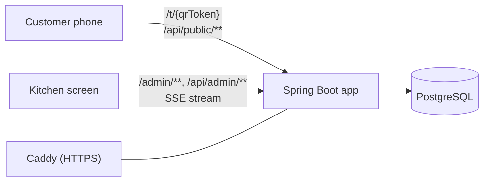
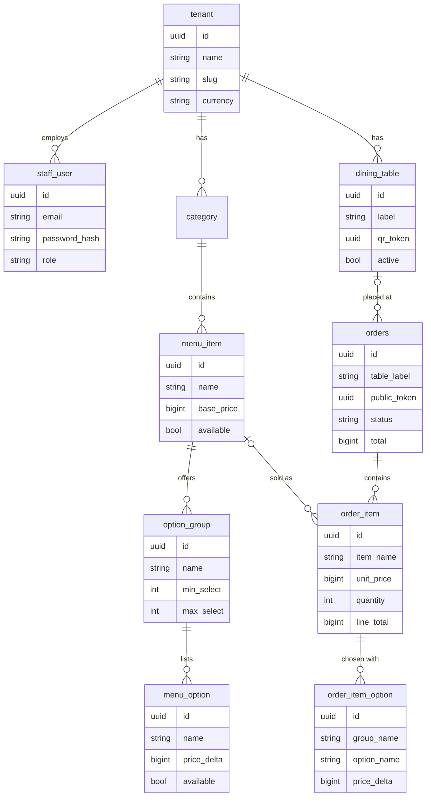

# TableTap

QR menus and ordering for restaurants. A restaurant signs up, builds its menu and prints one QR code per table. A customer scans the code, picks dishes and options on their phone and orders without an account. The kitchen sees the order appear live and moves it through to paid.

**Demo:** _add the URL after deploying_ · log in as `owner@pho.demo` / `tabletap-demo` (a second restaurant: `owner@banhmi.demo`, same password). API docs are at `/swagger-ui.html`.

<!-- Screenshots: add images of the customer menu (phone), the order status page and the kitchen board to docs/ and link them here. -->

## Features

- **Restaurants (tenants)** register an owner account and log in. Every restaurant sees only its own data.
- **Menu management.** Categories, items, prices, sold-out switch, and option groups such as "Size, choose 1" or "Toppings, up to 3" with a price for each option.
- **Tables and QR codes.** One code per table, a printable sheet, and a button to replace a code so an old printout stops working.
- **Customer ordering** on a phone-first page. The cart is kept in the browser until the order is sent. The server checks every choice against the menu and computes the price itself.
- **Order status page** for the customer, updated every few seconds.
- **Live kitchen board.** New orders appear without a refresh (Server-Sent Events). Staff move each order through New, Accepted, Cooking, Served and Paid, or cancel it.

## Stack

Java 21, Spring Boot 3.5 (Web, Data JPA, Security, Validation, Thymeleaf), PostgreSQL 16 with Flyway, JWT in an HttpOnly cookie, ZXing for QR codes, springdoc-openapi, plain JavaScript on the front end. Tests use JUnit 5, AssertJ and Testcontainers. Docker Compose and Caddy run it in production.

## Architecture

The code is grouped by feature under `heeyoung.tabletap`: `tenant`, `auth`, `menu`, `floor` (tables and QR codes), `order`, `kitchen`, `demo` and `common`. Controllers take and return records. Entities stay inside services.



Design decisions worth knowing:

1. **One database, a `tenant_id` on every row.** Entities carry Hibernate's `@TenantId`, so Hibernate adds the tenant filter to every query and sets the column on insert. A forgotten `WHERE` cannot leak another restaurant's data. Staff requests get the tenant from the JWT. Customer requests get it from the QR token or the order's public token, looked up with plain SQL because the tenant is not known yet. A query that runs with no tenant matches nothing.
2. **QR codes carry a random token**, never a restaurant or table id, so nothing in the URL can be guessed.
3. **Money is a whole number** in the smallest currency unit (`BIGINT`). No floating point.
4. **The server owns pricing.** An order request carries only item ids, option ids, quantities and notes. `OrderPricing` checks it against `CustomerMenu`, the same view of available items the customer was shown, and computes every price. Prices sent by a client are ignored.
5. **Orders copy what was sold.** Item names, option names, prices and the table label are stored on the order, so editing the menu or deleting a table never changes a past order.
6. **Order status is one state machine** in `OrderStatus`. An illegal move returns HTTP 409.
7. **Live updates are sent after commit**, so the kitchen never sees an order that was rolled back. Each restaurant's screens receive only that restaurant's events.

### Data model



Every table except `tenant` also has `tenant_id`.

## Run it

With Docker:

```bash
docker compose up
```

Then open http://localhost:8080 and log in as `owner@pho.demo` / `tabletap-demo`. Each demo table's QR code opens its customer page.

For development, start only the database and run the app with Gradle:

```bash
docker compose up postgres
```

```bash
./gradlew bootRun --args='--spring.profiles.active=dev,demo'
```

To scan codes with a phone on the same network, set `APP_BASE_URL=http://<your computer's LAN IP>:8080` before starting.

## Tests

```bash
./gradlew test
```

Integration tests start PostgreSQL with Testcontainers when Docker is running. Without Docker, point them at an existing database:

```bash
TEST_DATABASE_URL=jdbc:postgresql://localhost:5432/tabletap ./gradlew test
```

With neither, they are skipped locally. CI fails instead of skipping.

## Deploy

The production setup is one small Linux server running `compose.prod.yaml`: PostgreSQL (not reachable from outside), the app, and Caddy, which gets an HTTPS certificate for your domain.

1. Create the server (for example an AWS EC2 `t3.micro` with Ubuntu). Open only ports 22, 80 and 443. Set a billing alarm.
2. Add 1 GB of swap, since the server has 1 GB of memory:
   `sudo fallocate -l 1G /swapfile && sudo chmod 600 /swapfile && sudo mkswap /swapfile && sudo swapon /swapfile`
3. Install Docker and the Compose plugin.
4. Point your domain's DNS A record at the server's public IP.
5. Clone the repository, copy `.env.example` to `.env` and fill it in.
6. Start it: `docker compose -f compose.prod.yaml up -d --build`.

Settings are read from environment variables: `DB_URL`, `DB_USERNAME`, `DB_PASSWORD`, `JWT_SECRET`, `APP_BASE_URL`. Never commit them.

## Known limitations

- Anyone with a table's URL can order from anywhere. Real products add a session code or staff confirmation. The Accepted step is the mitigation here.
- Live updates are held in the app's memory, so it runs as a single instance.
- No rate limiting on the public endpoints.
- Kitchen events are written on the request thread after commit, so a kitchen screen on a stalled connection can slow down the request that placed or moved an order.
- The kitchen list shows the newest 200 open orders. Orders that are served but never marked paid stay open.
- No online payment, customer accounts, inventory, image upload (items take an image URL) or translations.
